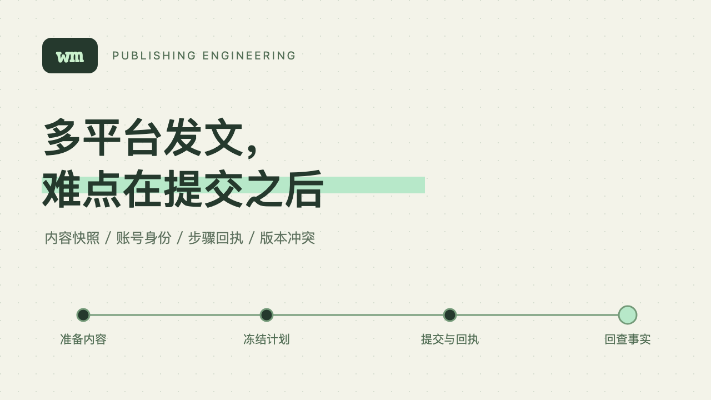

# 多平台发文，难点在提交之后



一次发表请求发出去了，浏览器却断线了。此时再点一次，可能得到两篇文章；直接告诉用户“失败了”，也可能把已经成功的文章留在后台，下一轮又重发。

写多平台发布工具时，这个场景比“怎么找到发表按钮”更值得提前处理。按钮定位错了通常会停下来，成功之后丢了回执却很容易制造重复内容。

[wm](https://github.com/Ganzhib/wemedia-cli/tree/master) 从掘金 CLI 派生，目标是让 AI 用同一套命令管理多个平台。它没有把所有平台硬塞进相同表单：掘金需要分类、标签和专栏，公众号有排版与封面，小红书的图文正文有长度限制，知乎使用专栏编辑器。通用的部分放在账号、内容计划和执行记录里。

## 计划冻结的是内容，不是路径

如果任务只保存 `article.md` 这个文件名，扫码期间修改文件，最后提交的内容就会和预览不同。图片更容易被忽略：正文没变，但同名封面已经被替换了。

wm 的内容准备阶段会读取源文件和本地素材，按 SHA-256 摘要保存完整字节。平台渲染器再从这些内容生成自己的产物。计划记录内容修订、平台产物、账号身份和工作流版本，后续执行使用这份快照，不回头读正在编辑的原稿。

下面这组命令可以把准备与执行分开。账号需要事先登录；第一条命令只建立草稿计划，不创建远端文章。

```bash
wm article plan article.md --to wechat:main --intent draft --json
wm plan inspect PLAN_ID --json
wm plan export PLAN_ID --directory ./preview --json
wm plan run PLAN_ID --json
```

命令里的 `PLAN_ID` 来自第一条命令的返回值。`inspect` 展示冻结的结构化产物，`export` 导出保存的正文产物。如果改稿后又建立一份计划，`wm plan diff OLD_ID NEW_ID --json` 可以比较字段、正文与图片顺序的变化。源文件保持原样，不会被平台图片地址改写。

这个设计有一个实际取舍：本地图片冻结的是字节，远程图片链接冻结的是 URL。URL 背后的内容仍可能变化，所以需要原生上传的平台要求提供本地素材，不能把一个地址摘要解释成图片内容已经固定。

## 账号别名不是发布身份

`main`、`work` 这样的名字便于使用，但用户可以把它们重新绑定到别的账号。旧任务如果执行时再去解析 `main`，可能把原来准备给个人号的内容发到工作号。

wm 登录后保存平台的稳定账号 ID，计划绑定这个身份。别名只是查找入口。同一个账号有多个别名时，共用会话目录和账号锁；执行前在同一个连接里读取在线身份，发现不一致就停止。

重新登录也可以指定原绑定，而不是跟随已经变化的别名。返回结果中的 `next_action` 会给出具体参数，AI 不需要自行猜测原账号。Cookie 和浏览器 Profile 留在本机，任务记录只保存必要身份和资源引用。

## 回执要比任务摘要更可靠

一个多目标任务可以先发掘金和公众号，之后再发掘金和其他平台。只按整批任务去重，第二批里的掘金仍然可能重复执行。

wm 把操作记录建立在真实账号、能力、内容修订和实际产物之上。目标列表的顺序和别名不参与这份身份。两批任务重叠时，已经完成的目标引用原操作记录。

操作内部也有边界：上传图片、创建草稿、提交发表分别保存状态。某一步成功，后面的步骤失败，恢复时跳过已完成步骤。任务摘要、事件日志和内容索引都从这些记录派生；索引写入失败不会把已发生的远端效果变成“尚未执行”。

但“有恢复机制”不代表任何失败都能重试。一次写入结果未知，驱动需要给出对应原操作的证据，才能确认成功或确认未发生。只有草稿存在，不能证明发表没有发生；列表里暂时找不到文章，也可能只是审核或索引延迟。没有证据时保留 `unknown`，比制造一份看起来完整的成功结果更有用。

## 更新草稿要面对平台上的编辑

用户可能在公众号后台改过摘要，也可能调整了图文顺序。工具只拿着旧 Markdown 直接覆盖，会丢掉这些修改。

wm 的更新入口接收完整远端基准快照。写入前重新读取，内容版本不同就返回字段差异，停止更新。确认之后建立新计划，不会替用户自动解决编辑冲突。

```bash
wm resource get draft DRAFT_ID --platform wechat --output base.json --json
wm draft update article.md --platform wechat --base base.json --json
```

`DRAFT_ID` 必须替换为自己的草稿 ID。公众号一组图文可能包含多篇文章，因此还需要通过能力契约指定子项。版本检查覆盖整组，实际修改只作用于选定子项；不明确选择时拒绝多篇更新。后续从已有草稿发表，也沿用原资源，不通过新建同标题草稿来绕过更新流程。

这里没有平台提供的原子比较并交换接口。读取之后、提交之前，外部编辑仍可能发生。工具能缩短检查与写入的距离，并在保存后回读，但不能把浏览器自动化包装成数据库事务。多人同时编辑时，仍需要协调操作窗口。

## 平台知识应该留在平台里

统一 CLI 不要求统一所有能力。小红书没有注册持久化草稿能力时，AI 应该明确说明限制；公众号发表不包含群发；知乎的自动保存需要服务器回读确认。把这些差异藏在一个“万能发布”按钮后面，只会让调用者难以判断结果。

wm 用一个 Skill 作为入口，按需读取各平台的指导。代码通过同一份能力注册生成输入输出契约，CLI 和页面都从实际注册结果展示能力。扩展一个平台时，公共核心继续处理身份、快照、计划和回执，平台实现负责选项、限制与真实调用。

当前浏览器测试会拦截网络请求，验证上传字节、编辑器行为和异常恢复。真实登录、保存草稿、公开发表与审核结果分开记录。它们解决的是不同问题，不能互相替代。对发布工具来说，下一次页面调整后还能准确告诉用户“发生了什么”，比一次演示里全部亮绿灯更重要。
